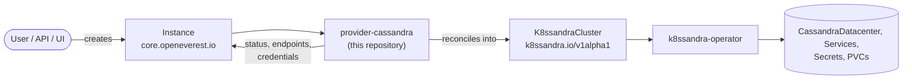

# Apache Cassandra Provider

> [!WARNING]
> **Pre-alpha.** OpenEverest v2 and this provider are under active development. CRD schemas,
> chart values and defaults change frequently, including in breaking ways, and there is no
> supported upgrade path between versions yet. Not for production use.

<!-- Remove the pre-alpha banner and the status badge at v2 GA. -->

[](https://github.com/openeverest/openeverest)
[](https://github.com/openeverest/provider-cassandra/actions/workflows/ci.yaml)
[](https://github.com/openeverest/provider-cassandra/releases)
[](https://pkg.go.dev/github.com/openeverest/provider-cassandra)
[](LICENSE)

Run **Apache Cassandra** on Kubernetes through
[OpenEverest](https://github.com/openeverest/openeverest), backed by the
[k8ssandra-operator](https://github.com/k8ssandra/k8ssandra-operator).

## What this is

OpenEverest providers translate a single, technology-agnostic `Instance` custom resource into
the native custom resources of an upstream Kubernetes operator — for databases, but equally
for caches, message queues, object storage, or model-serving runtimes. This repository is the
provider for **Apache Cassandra**: it owns the technology-specific knowledge — topologies,
versions, parameters, backup wiring — so that users, the API server, and the UI stay
technology-agnostic.

> [!IMPORTANT]
> **This provider is not standalone.** It requires an OpenEverest installation (core CRDs and
> controller) in the cluster. Installing this chart on its own does nothing.
> See [Install OpenEverest](https://openeverest.io/documentation/current/quick-install.html).



The provider watches `Instance` resources whose `spec.providerRef.name` is `provider-cassandra`,
and reports workload health back onto `Instance.status`. It never manages pods directly — all
lifecycle work is delegated to the operator.

## Compatibility

| provider-cassandra | OpenEverest | k8ssandra-operator | Kubernetes |
|---|---|---|---|
| `0.2.x` | `2.0.0-alpha.1` | `1.34.x` | `1.32` – `1.34` |
| `0.1.x` | `2.0.0-dev.1` | `1.34.x` | `1.30` – `1.34` |

## Capabilities

What you can do to a running instance through the `Instance` API. Upgrading the
provider itself is covered under [Installation](#installation).

| Capability | Status | Notes |
|---|---|---|
| Provisioning | ✅ | |
| Horizontal scaling | ✅ | `spec.components.engine.replicas` |
| Vertical scaling (CPU / memory) | ✅ | `spec.components.engine.resources` |
| Version upgrades | ✅ | of the deployed Cassandra version — change `spec.version`; see [Versions](#versions) |
| Monitoring | ✅ | Metrics of the Cassandra pods published for monitoring extensions through `spec.monitoring.destinations`. See [Monitoring](#monitoring) |
| Repairs | ✅ | optional `repair` component (Reaper); see [Repairs](#repairs) |

Stateful workloads additionally report:

| Capability | Status | Notes |
|---|---|---|
| Persistent storage | ✅ | `spec.components.engine.storage` |
| Storage expansion | ✅ | when the StorageClass allows volume expansion |
| Backups (on demand) | ✅ | operator-native (`executionMode: ProviderManaged`) via Medusa; a backup stays `Pending` until the cluster has finished applying changes and Medusa is ready on every node, such as during the rollout that enabling backups starts |
| Restore | ✅ | in place, via Medusa restore jobs |
| Scheduled backups | ✅ | recurring backups via Medusa's native scheduler; retention (`retention`, `count` type only) is enforced cluster-wide, not per-schedule |
| PITR | 🚧 | not yet supported |

## Installation

The provider chart is published as an OCI artifact on GHCR:

```bash
helm install provider-cassandra oci://ghcr.io/openeverest/charts/provider-cassandra \
  --version 0.2.0 \
  --namespace everest-system
```

- The k8ssandra-operator (with cass-operator and Medusa CRDs) is bundled as a chart dependency
  and is installed automatically. Set `operator.enabled=false` to use an externally managed
  operator instead.
- The operator is installed **cluster-scoped** (`global.clusterScoped=true`) so it reconciles
  `Instance`-backed clusters in any namespace.
- The chart registers an admission webhook, so an invalid `Instance` is rejected when it is
  written, with every error and its field path. Its serving certificate is generated by the
  chart and kept across upgrades; set `admission.certManager.enabled=true` to have
  cert-manager issue it, or supply one through `admission.certs`. If the provider is down,
  writes are admitted and the `Instance` reports the errors in its `Ready` condition. A
  missing object the `Instance` names, such as its user Secret, is never a reason to reject
  it: `kubectl` prints a warning, and the `Instance` reports it once created.
- The chart installs a `ClusterInstancePreset` per topology, the starting points the UI offers
  when you create an Instance in any namespace: `cassandra-singledatacenter` (3 nodes with
  1 CPU, 4Gi and 25Gi each). Change or disable it, or add your own, under `presets` in the
  chart values; `provider.shortName` prefixes their names. Presets pin the provider's default
  [version](#versions) bundle and reference no namespaced objects.

> [!IMPORTANT]
> The operator's admission webhooks require [cert-manager](https://cert-manager.io) to be
> installed in the cluster before installing this chart.

Upgrade and uninstall:

```bash
helm upgrade provider-cassandra oci://ghcr.io/openeverest/charts/provider-cassandra \
  --version 0.2.0 --namespace everest-system
helm uninstall provider-cassandra --namespace everest-system
```

A pre-upgrade hook checks that every `Instance` can follow the new version catalog, then
upgrades the bundled operator's CRDs — Helm itself installs the CRDs of a chart dependency only
once. With `operator.enabled=false` the CRDs stay yours to upgrade.
Uninstalling the chart does **not** delete running `Instance` resources or their data.

## Usage

Verify that the provider registered itself:

```bash
kubectl get providers.core.openeverest.io provider-cassandra
```

Create an instance:

```yaml
apiVersion: core.openeverest.io/v1alpha1
kind: Instance
metadata:
  name: my-instance
spec:
  providerRef:
    name: provider-cassandra
  version: "5.0"
  topology:
    type: singleDatacenter
  components:
    engine:
      type: cassandra
      replicas: 3
      resources:
        requests:
          cpu: "1"
          memory: 4Gi
      storage:
        size: 25Gi
    repair:
      type: reaper
```

Component names are defined by this provider — see [definition/provider.yaml](definition/provider.yaml).
`spec.version` and `spec.topology` are optional; the provider defaults apply.
The UI takes CPU in cores, fractions included (`1.5`), and memory, disk and the JVM heap sizes in
Gi, and writes them as quantity strings; a value it did not change keeps its stored form (for
example `3584Mi`).
More examples live in [examples/](examples/).

Watch it come up and read the connection details:

```bash
kubectl get instance my-instance -w
kubectl wait instance/my-instance --for=condition=Ready --timeout=20m
kubectl get instance my-instance -o jsonpath='{.status.connection}'
```

Credentials are in the secret named by `.status.connection.credentialsSecretRef`.

The provider reports what it observes, and OpenEverest turns it into the Instance's conditions
the same way for every provider. `status.phase` is `Pending` until Cassandra has first served
clients, then `Provisioned`. Read the conditions for the rest:

| Fact | How this provider determines it |
|---|---|
| **`Ready`** | k8ssandra-operator has observed the latest spec, no datacenter operation is running, every engine pod the datacenter asks for exists and is ready, Reaper is ready when the `repair` component is set, and no restore runs. Until then the `Ready` message says what is waited for: `Adding Cassandra nodes`, `Removing Cassandra nodes`, `Restarting Cassandra nodes`, `Rolling out changes`, `Waiting for Cassandra nodes to become ready`, `Waiting for Reaper to become ready`, … |
| **`Available`** | `True` while at least one Cassandra pod is ready, so it stays `True` through a rolling change; `False` with `NoNodeReady` when none is, or `NodesStopped` while the datacenter is stopped (a Medusa restore stops it) |
| **Problems** (`EngineHealthy`) | `ClusterError` when k8ssandra-operator reports an error; `ChangeRejected` when cass-operator refuses a change, for example a volume that cannot be resized. A rejected change needs the spec to be corrected, so it stalls the Instance at once |
| **Operations** | `Upgrading` (reason `RollingOutImage`) while engine pods still run another Cassandra image than the version asks for; `StorageResizing` while cass-operator resizes volumes; `Restoring` while a `Restore` runs |
| **Connection details** | Published as soon as clients can connect, and kept current while a change rolls out |

`status.components` reports the ready, total and desired pods of `engine` and, with the
`repair` component, of Reaper's single pod. Medusa runs as a sidecar of the Cassandra pods, so
`backupAgent` has no entry of its own.

## Monitoring

Monitoring is an OpenEverest extension. The k8ssandra management API serves Cassandra's
metrics on every Cassandra pod, on container port `metrics` (9000, `/metrics`). Once Cassandra
is initialized, the provider publishes that endpoint in
`Instance.status.monitoring.sources.metrics`, and a monitoring extension creates the scrape
objects from it. To send an Instance's metrics somewhere:

1. Install a monitoring extension, such as
   [monitoring-prometheus](https://github.com/openeverest/monitoring-prometheus), which
   installs its `MonitoringClass`.
2. Create a `MonitoringDestination` of that class (in the UI: **Settings → Monitoring
   destinations**).
3. List it on the Instance (in the UI: the wizard's monitoring step, or the instance overview):

```yaml
spec:
  monitoring:
    destinations:
      - name: metrics
        destinationRef:
          name: prometheus
```

The endpoint is always served, so adding or removing a destination restarts nothing. It stays
published without a destination, so a scraper OpenEverest doesn't configure (your own
`ServiceMonitor`, a Datadog agent, Grafana Alloy) can read its pod selector, port, path and
scheme from the Instance status. Medusa and Reaper publish no metrics.

> [!IMPORTANT]
> The `monitoring` component (type `prometheus`) is gone: an Instance that lists it is
> rejected. The provider no longer turns on k8ssandra-operator's Prometheus telemetry, and the
> operator deletes the `ServiceMonitor` it created. To collect metrics, list a destination in
> `spec.monitoring.destinations`.

## Repairs

Cassandra needs every keyspace repaired within `gc_grace_seconds` (10 days by default),
or deleted data can reappear. Add the `repair` component and the provider runs
[Reaper](https://cassandra-reaper.io) next to the cluster:

```yaml
spec:
  components:
    repair:
      type: reaper
```

- Reaper schedules repairs for every non-system keyspace, and picks up new keyspaces within
  ten minutes. Repairs are incremental on Cassandra 4 and later.
- It is one pod, with 100m CPU and 1Gi memory by default; set `resources` to change that. The
  JVM heap is half the memory limit. Its state lives in the `reaper_db` keyspace of the
  cluster it repairs.
- `version`, `image`, `resources`, and the `tolerations` and `affinity` of
  `schedulingPolicy` are supported. `image` needs a tag, not a digest.
- Adding or removing the component does not restart Cassandra. Removing it leaves the
  `reaper_db` keyspace in place.
- The component is opt-in: an `Instance` without it is accepted with a warning. While Reaper
  is not ready the `Instance` is not `Ready`, and its `Ready` message says it waits for Reaper.

## Topologies

<!-- BEGIN GENERATED: topologies -->
| Topology | Default | Description |
|---|---|---|
| `singleDatacenter` | ✅ | A single Cassandra datacenter (`dc1`) built from the `engine` component |
<!-- END GENERATED: topologies -->

The `backupAgent` (Medusa) and `repair` (Reaper) components are optional. Monitoring is configured
on the Instance (`spec.monitoring.destinations`), not as a component; see [Monitoring](#monitoring).

## Versions

<!-- BEGIN GENERATED: versions -->
| Version bundle | Default | cassandra | medusa | reaper |
|---|---|---|---|---|
| `5.0` | ✅ | `5.0.4` | `0.22.3` | `5.1.0` |
| `4.1` | | `4.1.9` | `0.22.3` | `5.1.0` |
<!-- END GENERATED: versions -->

Source of truth: [definition/versions.yaml](definition/versions.yaml).

The `cassandra` image is the k8ssandra management-api image; the operator must already support
the target version — upgrade the provider chart first.

## Configuration

- **Chart values:** [charts/provider-cassandra/values.yaml](charts/provider-cassandra/values.yaml)
- **Instance parameters:** per-component and per-topology `parameters` schemas, defined under
  [definition/](definition/) and published on the `Provider` resource
  (`kubectl get provider provider-cassandra -o yaml`). The provider rejects an Instance that
  does not match them, and the UI checks the form against them as you type.

The technology-specific knobs worth knowing about:

| Parameter | Applies to | Purpose |
|---|---|---|
| `heapInitialSize`, `heapMaxSize` | `engine` | JVM heap (`-Xms`, `-Xmx`) as quantities; with both unset, the heap is half the container memory limit (or request), at most 31744Mi |

Cassandra would size the JVM from the node's memory, not the container's, and a container on a
large node would then be OOM-killed. The provider sizes it from the container's memory instead,
as Cassandra does from the machine's: half for the heap unless set, a quarter for direct memory
(`-XX:MaxDirectMemorySize`). A cluster created before the provider sized the JVM keeps its JVM
settings, since changing them restarts every node; set both heap sizes to size its heap.

## Development

Requires Go (see [go.mod](go.mod)), Docker, Helm, kubectl, and a Kubernetes cluster you can
reach. [dev/README.md](dev/README.md) covers the environment end to end: the recommended
local k3d setup, running against a cluster you already have, and every `dev/.env` setting.

```bash
make dev-up             # local cluster + Tilt dev environment (see dev/README.md)
make generate           # RBAC, provider spec, Helm chart sync
make run                # run the provider locally against the cluster
make test-unit
make test-integration   # chainsaw suites under test/integration/
make dev-down
```

`make help` lists every target. `make verify` fails when generated files are stale — run
`make generate` and commit the result.

The provider contract (`Validate` / `Sync` / `Status` / `Cleanup`), RBAC markers, watches,
code generation, and the backup/restore interfaces are documented once for all providers in
[PROVIDER_DEVELOPMENT.md](https://github.com/openeverest/provider-sdk/blob/main/PROVIDER_DEVELOPMENT.md).

### Layout

| Path | Purpose |
|---|---|
| `cmd/provider/` | Entry point |
| `internal/provider/` | `ProviderInterface` implementation, backup interfaces, RBAC markers |
| `internal/common/` | Component name constants |
| `definition/` | Provider identity, component types, versions, topologies, backup classes |
| `charts/provider-cassandra/` | Helm chart (`generated/` is produced by `make generate`) |
| `config/rbac/role.yaml` | Generated `ClusterRole` — do not edit |
| `test/integration/` | Chainsaw suites: `core` |
| `examples/` | Example `Instance` resources |
| `dev/` | Tilt dev environment, `.env` configuration, k3d cluster config |
| `.github/workflows/` | CI: lint, build, unit and integration tests, release |

### Testing

- **Unit tests** — `make test-unit`.
- **Integration tests** — chainsaw suites under [test/integration/](test/integration/).
  Individual suites are also exposed as make targets (`make test-integration-core`, …).
- **CI** — [.github/workflows/ci.yaml](.github/workflows/ci.yaml) runs lint, build, unit
  tests, generated-file verification, Helm lint, and each integration suite on every pull
  request.

## Troubleshooting

```bash
kubectl logs -n everest-system deploy/provider-cassandra -f
```

| Symptom | Where to look |
|---|---|
| `Instance` stuck in `Creating` | `kubectl describe instance <name>` conditions, then the provider logs |
| No `Provider` resource in the cluster | Is the chart installed? Check the provider deployment logs |
| `Instance` ignored entirely | `spec.providerRef.name` must be `provider-cassandra` |
| `K8ssandraCluster` created but not reconciled | Confirm the operator is running and cluster-scoped, and that cert-manager is installed |
| `K8ssandraCluster` created but no pods | Inspect the `K8ssandraCluster` / `CassandraDatacenter` status — the failure is upstream in the operator |
| Readiness probe `500` right after start | Normal during Cassandra's first boot; wait for the `CassandraDatacenter` to reach `Ready` |